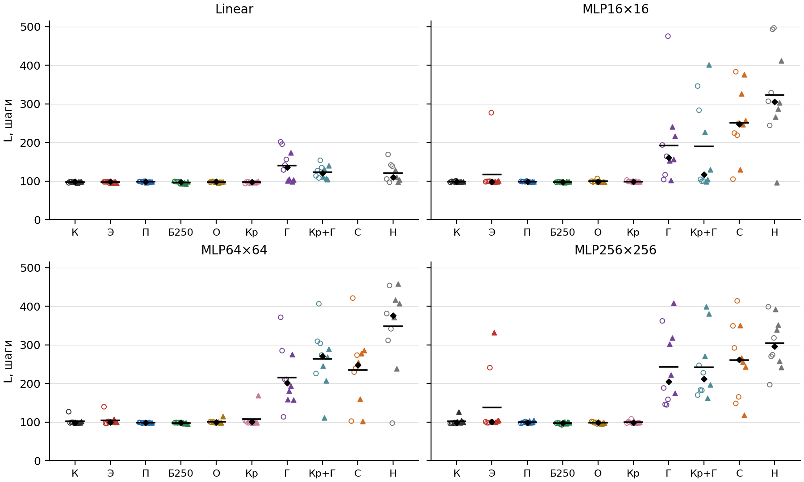

# Отрицательный перенос в PPO при инверсии ресурсов

Код, данные и итоговые модели к статье

> Воротынцев Г.А. Отрицательный перенос в PPO при инверсии ресурсов: препятствие в политике, а не в функции ценности // Сборник статей Санкт-Петербургской научно-технологической конференции «Цифровая трансформация: наука – технологии – общество». СПб., 2026 (в печати).

**Вопрос.** Агент обучен алгоритмом PPO в мире, где ресурс A полезен, а B вреден. Затем полезность ресурсов меняется местами. Почему продолжение обучения уступает обучению с нуля и какой компонент агента мешает переучиться?

**Ответ, коротко.** Мешает обученная политика. Переинициализация её выходного или скрытых слоёв возвращает способность освоить новый мир. Сброс оптимизатора или функции ценности, повышение энтропии, плавная смена правил и запас энергии — не возвращают. 10 сидов × 4 архитектуры, 51,2 млн шагов обучения.



<!-- table1:start -->
Итоговая длина эпизода L в мире B, шаги: среднее ± SD по 10 запускам. В скобках — съеденный полезный ресурс за эпизод; * — отличие от К значимо (p < 0,05, точный перестановочный тест с поправкой Холма).

| Условие | Linear | MLP16×16 | MLP64×64 | MLP256×256 |
|---|---|---|---|---|
| К | 98 ± 1 (0.1) | 98 ± 1 (0.1) | 102 ± 9 (0.2) | 102 ± 9 (0.2) |
| Э | 97 ± 2 (0.1) | 117 ± 56 (0.9) | 104 ± 13 (0.4) | 138 ± 81* (2.5) |
| П | 98 ± 1 (0.1) | 99 ± 1 (0.1) | 99 ± 1 (0.1) | 100 ± 3 (0.1) |
| Б250 | 96 ± 3 (0.1) | 98 ± 1 (0.0) | 98 ± 1 (0.1) | 97 ± 3 (0.1) |
| О | 98 ± 1 (0.1) | 99 ± 3 (0.1) | 101 ± 5 (0.2) | 98 ± 2 (0.1) |
| Кр | 97 ± 2 (0.1) | 99 ± 2 (0.1) | 107 ± 22 (0.4) | 100 ± 4 (0.2) |
| Г | 141 ± 40* (4.0) | 192 ± 110* (10.3) | 216 ± 76* (9.5) | 243 ± 97* (9.5) |
| Кр+Г | 123 ± 17* (2.1) | 189 ± 117* (8.7) | 264 ± 77* (18.2) | 242 ± 85* (11.6) |
| С | — | 252 ± 92* (13.3) | 235 ± 96* (13.0) | 261 ± 96* (11.0) |
| Н | 120 ± 24 (2.4) | 324 ± 120 (30.8) | 348 ± 110 (27.2) | 304 ± 67 (22.1) |
<!-- table1:end -->

Обозначения:
- **К** — обычное продолжение обучения;
- **Э** — повышенная энтропия;
- **П** — плавная смена правил;
- **Б250** — запас энергии 250;
- **О** — новый оптимизатор;
- **Кр** — сброс функции ценности;
- **Г** — сброс выходного слоя политики;
- **Кр+Г** — сброс функции ценности и выходного слоя;
- **С** — сброс скрытых слоёв политики;
- **Н** — обучение с нуля.

L ≈ 100 — агент ничего не ест и живёт на начальном запасе энергии. Подробности — в [docs/protocol.md](docs/protocol.md).

## Структура

```
configs/experiment.json      все параметры эксперимента (среда, сети, PPO, сиды, бюджет, статистика)
src/energygrid_transfer/
    env.py                   среда EnergyGrid
    agents.py                создание и загрузка PPO-агентов
    interventions.py         вмешательства и сбросы (одна функция apply_reset на все сбросы)
    training.py              этапы: мир A, ветви в мире B, контроли, продолжение Г+
    evaluation.py            оценка на фиксированных стартах
    behaviour.py             прохождения, направление действий, застревание, активации, случайные состояния
    stats.py                 бутстреп, точный перестановочный тест, поправка Холма
scripts/
    run_experiment.py        обучение (вся матрица или любая её часть, с продолжением после остановки)
    collect_runs.py          оценки из папки запусков -> таблица в формате data/
    evaluate_behaviour.py    поведение итоговых моделей -> data/rollout_episodes.csv.gz, data/behaviour.csv
    summarize.py             все числа статьи -> results/summary.json, results/table1.md
    make_figures.py          рисунки -> figures/
tools/import_original_runs.py  как data/ и архив моделей получены из исходных папок запусков
data/                        данные (описание столбцов — docs/data.md)
results/                     итоговые числа
tests/                       тесты среды, сбросов, статистики и побитовой воспроизводимости
```

## Установка

Python 3.13, CPU. Видеокарта не нужна.

```bash
pip install -r requirements.txt
pip install -e .
```

## Воспроизведение

**1. Таблица, все числа статьи и рисунки из данных** (около минуты):

```bash
python scripts/summarize.py
python scripts/make_figures.py
```

**2. Поведение итоговых моделей** (около часа на 11 ядрах). Нужен архив моделей из [релиза](https://github.com/www013851/fuzzy-octo-doodle/releases/tag/v1.0.0), около 140 МБ:

```bash
gh release download v1.0.0 -R www013851/fuzzy-octo-doodle -p checkpoints.zip
unzip checkpoints.zip
python scripts/evaluate_behaviour.py --checkpoints checkpoints --workers 8
```

**3. Всё обучение с нуля** (500 запусков, около 6 часов на 8 ядрах):

```bash
python scripts/run_experiment.py --pilot --runs runs_pilot     # техническая проверка, ~2 мин
python scripts/run_experiment.py --stages all --workers 8       # полная матрица -> runs/
python scripts/collect_runs.py --runs runs --out data/evaluations_rerun.csv.gz
```

**Проверка воспроизводимости.** Код каждой серии запусков сведён в один пакет. `tests/test_reproducibility.py` переобучает первый интервал (10 240 шагов) каждого типа этапа и сверяет хеш весов политики с записанным в `data/evaluations.csv.gz`. Для этого нужны точные версии библиотек из `requirements.txt` и архив моделей. Все 12 случаев совпадают побитово.

```bash
pytest -m "not slow"                                   # быстрые тесты
ENERGYGRID_CHECKPOINTS=checkpoints pytest -m slow      # побитовая проверка, ~10 мин
```

## Соответствие статье

| В статье | Здесь |
|---|---|
| Таблица 1 | `results/table1.md` |
| Рис. 1 | `figures/fig1_final_length.png` |
| Рис. 2 | `figures/fig2_behaviour.png` |
| Числа в тексте (разности, интервалы, p, доли застреваний, энтропия) | `results/summary.json`: `conditions`, `vs_K`, `vs_N`, `vs_G`, `rollouts`, `rollout_pairs` |

## Ограничения

- Одна среда и один вид смены правил — симметричная перестановка полезности двух ресурсов.
- Настройки PPO общие для всех сетей и не подбирались.
- Протокол дополнялся по ходу работы: повторная серия сидов и условия О и Г добавлены после анализа первой серии, С, Кр, Кр+Г и Г+ — после рецензии. Порядок серий — в [docs/protocol.md](docs/protocol.md).

## Лицензия и цитирование

Код — [MIT](LICENSE); данные и модели — CC BY 4.0. Как цитировать — [CITATION.cff](CITATION.cff).
